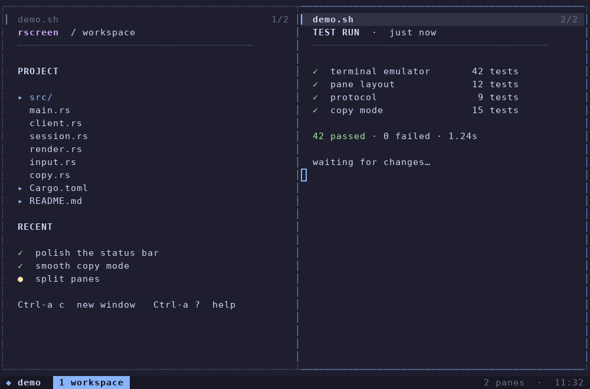
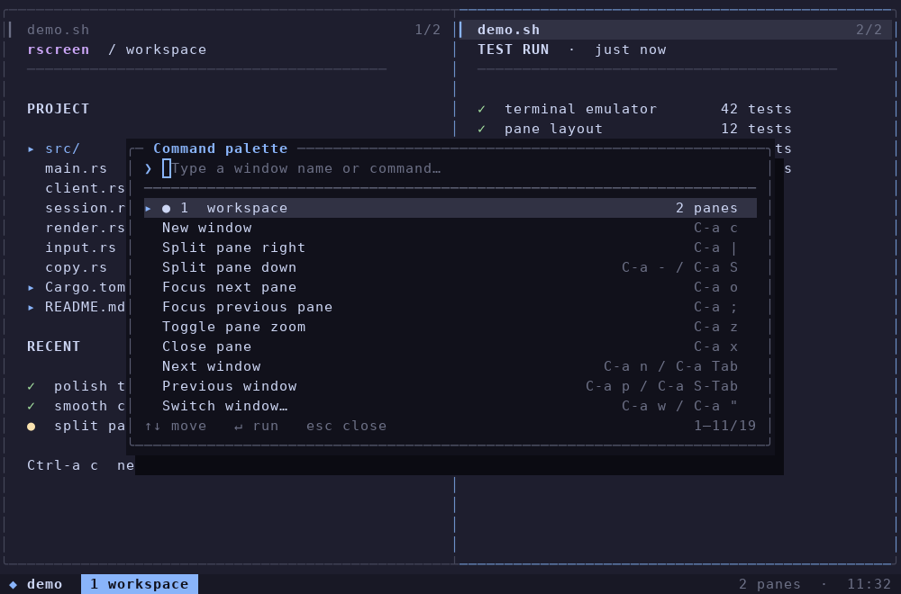
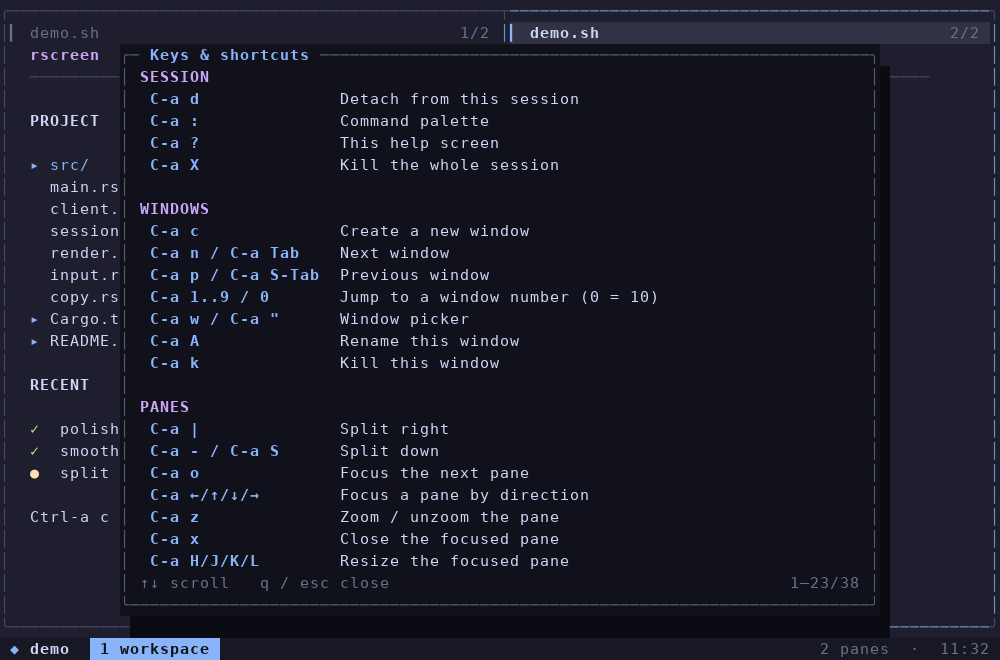
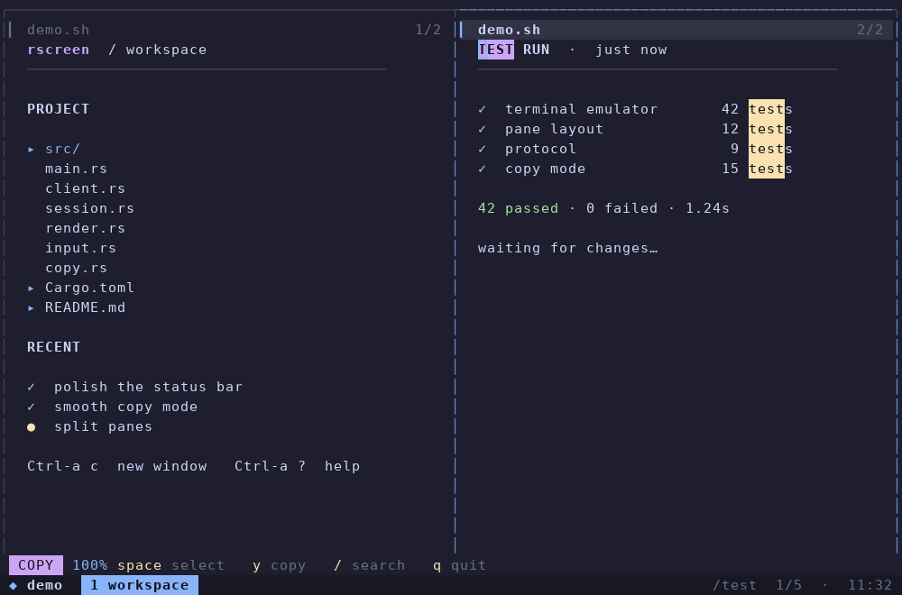

# rscreen

A modern, elegant terminal multiplexer for Unix, inspired by GNU Screen.

rscreen keeps your shells alive across disconnects and adds the comfort of a
contemporary TUI: a Catppuccin status bar, tabbed windows, rounded split frames,
a searchable command palette, a keybinding overlay, vi-style copy mode and
mouse support — all in one small Rust binary.



## Highlights

- **Session persistence** — detach, close the terminal, SSH back in and reattach.
- **Windows and splits** — tabbed windows, nested side-by-side/stacked panes,
  zoom, rename and per-pane focus.
- **Copy mode** — frozen scrollback snapshot, vi keys, selections, search,
  internal paste buffer and OSC 52 clipboard sync.
- **A UI that explains itself** — status bar with window tabs, transient key
  hint strip, command palette, help screen, confirmations and toast messages.
- **Mouse** — click to focus, click tabs, wheel to scroll, drag to select and copy.
- **Correct terminal emulation** — VT100/xterm sequences, 256/truecolor,
  wide characters, combining marks, alternate screen, scroll regions,
  bracketed paste, focus and mouse protocols, hyperlinks.
- **Fast rendering** — semantic cells are diffed and emitted as minimal,
  synchronized ANSI updates instead of repainting the whole screen.
- **Multiple clients** — attach several terminals to the same session.
- **No server dependency** — a single binary acts as both the client and the
  session daemon.

| Command palette | Help & shortcuts |
| --- | --- |
|  |  |

| Copy mode + search |
| --- |
|  |

## Why another screen?

GNU Screen is wonderful and nearly indestructible, but its status line is from a
different era. This project keeps the muscle memory (`C-a` prefix, detach,
windows, copy mode) while giving the interaction model a careful redesign:

- active window and pane are visually obvious;
- the prefix key shows a hint strip instead of silently swallowing the next key;
- every action is discoverable through `C-a ?` and a fuzzy command palette;
- resizing, splitting and closing panes cannot leave the layout in a broken state;
- the terminal is always restored, even when the client exits on an error.

The window-list hardstatus idea comes from [GNU Screen](https://www.gnu.org/software/screen/)
and [yudai/screen](https://github.com/yudai/screen). rscreen is an original
implementation in Rust, not a port of that code.

## Installation

Requirements: a Unix-like OS (Linux is best supported), Rust 1.85+, and a
modern terminal.

```sh
git clone <this repository>
cd rscreen
cargo build --release
install -m755 target/release/rscreen ~/.local/bin/rscreen
# or simply
cargo install --path .
```

## Quick start

```sh
rscreen                 # create a session, or attach if exactly one exists
rscreen -S work         # use/create a named session
rscreen new work -d     # create it detached (scripts, boot commands)
rscreen ls              # list sessions
rscreen attach work     # reattach
rscreen kill work       # terminate the session and its processes
rscreen detach work     # detach every client, keep the session running
```

Inside a session:

```text
C-a d      detach
C-a ?      show all keys
C-a c      new window
C-a :      command palette
```

The default prefix is `C-a`, as in GNU Screen. `C-a C-a` sends a literal `C-a`
to the focused application. Prefix keys are configurable.

## Keybindings

`C-a` below stands for your configured prefix.

### Session

| Key | Action |
| --- | --- |
| `C-a d` | Detach this client |
| `C-a D` | Detach all clients |
| `C-a :` | Command palette |
| `C-a ?` | Help overlay |
| `C-a X` | Kill the session (asks for confirmation) |

### Windows

| Key | Action |
| --- | --- |
| `C-a c` | New window |
| `C-a n` / `C-a p` | Next / previous window |
| `C-a Tab` / `C-a S-Tab` | Next / previous window |
| `C-a 1..9` / `C-a 0` | Jump to window number (0 = window 10) |
| `C-a w` or `C-a "` | Window picker |
| `C-a A` | Rename the current window |
| `C-a k` | Kill the current window (confirmation) |

### Panes

| Key | Action |
| --- | --- |
| `C-a \|` | Split right |
| `C-a -` / `C-a S` | Split down |
| `C-a o` | Focus next pane |
| `C-a ;` | Focus previous pane |
| `C-a ↑ ↓ ← →` | Focus pane in a direction |
| `C-a H J K L` | Resize the focused pane |
| `C-a z` | Zoom / unzoom |
| `C-a x` | Close the focused pane (confirmation) |

### Copy mode

| Key | Action |
| --- | --- |
| `C-a [` | Enter copy mode |
| `hjkl` / arrows | Move |
| `w` / `b` | Word forward / backward |
| `0` / `$` | Start / end of line |
| `g` / `G` | Top / bottom of history |
| `PageUp` / `PageDown` | Page through history |
| `Space` or `v` | Start / clear a selection |
| `/` / `?` | Search forward / backward |
| `n` / `N` | Next / previous match |
| `y` or `Enter` | Copy and leave copy mode |
| `C-a ]` | Paste the copy buffer into the pane |
| `q` or `Esc` | Leave copy mode |

The copy buffer is mirrored to the system clipboard with OSC 52 when the
terminal supports it. Selections join wrapped lines without a newline and trim
trailing blanks.

### Mouse

- Wheel scrolls the focused pane (enters copy mode when needed).
- Drag selects text and copies it on release. Set `mouse_select = false` to
  disable this and keep native terminal selection.
- Click focuses a pane; click a window tab to switch windows.
- Applications that request mouse reporting receive translated SGR/X10 events.
- In the alternate screen with mode 1007 enabled, the wheel is sent to the
  application as arrow keys instead of entering copy mode.

> Mouse reporting means terminals require **Shift** for their native text
> selection, exactly like other mouse-enabled multiplexers. Set `mouse = false`
> if you prefer the terminal's selection all the time.

## Configuration

The config file lives at `~/.config/rscreen/config.toml` (respects
`$XDG_CONFIG_HOME` and `$RSCREEN_CONFIG`).

```sh
rscreen config           # print the path
rscreen config --init    # write a commented sample
rscreen config --print   # print the sample to stdout
```

A minimal example:

```toml
[general]
prefix = "C-b"          # C-a by default
scrollback = 5000
status_rows = 1         # 1 = compact, 2 = status + key hints
mouse = true
mouse_select = true
bell = "visual"         # visual | audible | off
clock = true
confirm_kill = true

[theme]
accent = "#89b4fa"
status_bg = "#181825"
# ... every palette color can be overridden; see `rscreen config --print`

[keys]
# Rebind any prefix action. Remove a binding with "none".
new_window = "c"
split_right = "|"
window_picker = "w"
```

The server reads the config when a session is created. Changes affect new
sessions; run `rscreen kill <name>` and create the session again to apply them.

## How it works

```text
┌──────────────────┐    framed input / ANSI diffs    ┌───────────────────────┐
│ rscreen client   │  <───────────────────────────>  │ rscreen session server│
│                  │        Unix domain socket       │                       │
│ raw terminal     │                                 │  windows + pane tree  │
│ restore guard    │                                 │  VT emulator per pane │
│ resize / mouse   │                                 │  PTY + child process  │
└──────────────────┘                                 └───────────────────────┘
```

- **Client** — puts the terminal into raw mode, enables mouse and bracketed
  paste, forwards input/resize events and paints the received ANSI frames. A
  guard restores termios, the alternate screen, mouse modes and the title stack
  on every exit path.
- **Server** — one daemon per session, owning PTYs, child processes, the terminal
  emulator, scrollback, window/pane layout and overlays. It keeps running when
  every client detaches.
- **Emulator** — a custom grid built on the `vte` parser: wide cells, scrollback,
  alternate screen, margins, charsets, SGR, OSC 7/8/9/52 and xterm mouse modes.
- **Renderer** — composes a semantic `Canvas` (characters, styles, hyperlinks),
  diffs it against the previous frame and emits a minimal ANSI update wrapped in
  synchronized-output markers. Wide glyphs and cursor shape changes are handled
  explicitly.

Runtime files live in `$XDG_RUNTIME_DIR/rscreen` (fallback
`/tmp/rscreen-$UID`): session sockets, lock files and per-session logs under
`logs/`. The directory is mode `0700` and sockets are `0600`.

## Development

```sh
cargo test              # unit + end-to-end protocol/UI tests
cargo clippy --all-targets
cargo fmt --all
```

The integration tests spawn real daemons and PTYs, attach over the real binary
protocol, feed keys/mouse reports and inspect the rendered screen through the
emulator. There are also CLI tests for detached sessions and config handling.

To regenerate the README screenshots (needs Python + Pillow):

```sh
./scripts/capture-screenshots.sh
```

## Releases

Version tags (`v*`) are built by GitHub Actions for Linux x86_64 and aarch64.
Each GitHub Release contains a `rscreen-vX.Y.Z-<target>.tar.gz` archive with
the binary, README, license and changelog, plus a SHA-256 checksum. See
[CHANGELOG.md](CHANGELOG.md) for release notes.

```sh
git tag -a v0.1.0 -m "rscreen v0.1.0"
git push origin v0.1.0
```

## Limitations

- Unix only; the server relies on PTYs and Unix sockets.
- Scrollback is not reflowed when the terminal width changes. History lines are
  truncated/padded instead; the live screen keeps its top-left content.
- Multiple attached clients share one layout. The most recently active client
  controls the pane dimensions; other clients get a consistent view of the same
  session at their own frame size.
- No Sixel/kitty graphics, no kitty keyboard protocol and no sixel image
  passthrough. Applications fall back to the classic protocols.
- Combining marks are supported; full grapheme clustering (ZWJ emoji sequences)
  is not.
- Copy mode on the alternate screen can only copy the alternate screen contents;
  primary-screen history is preserved after the application exits.
- OSC 52 clipboard sync depends on the outer terminal's policy.

## License

MIT. See [LICENSE](LICENSE).
